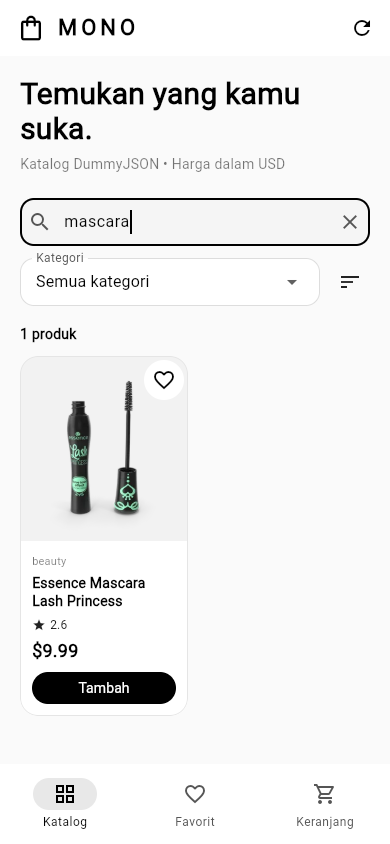
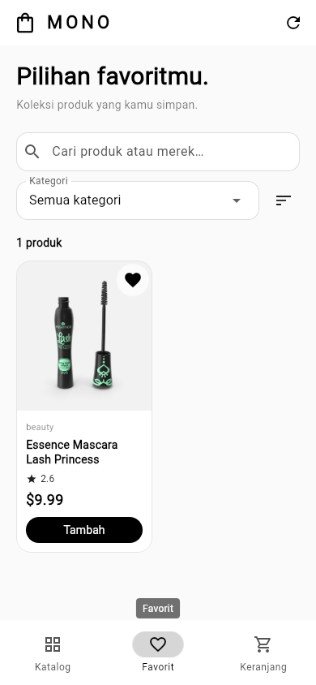
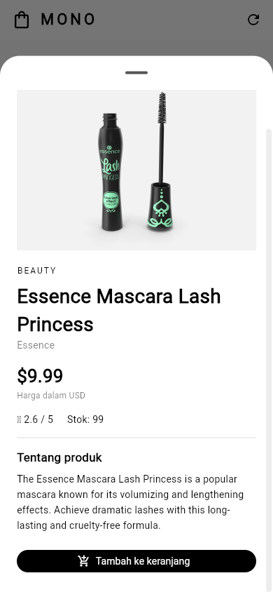
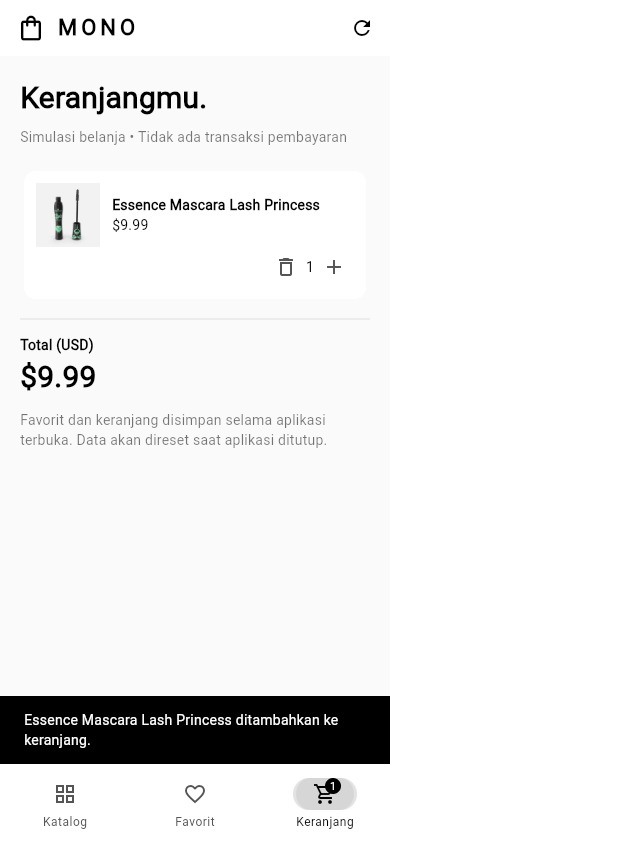
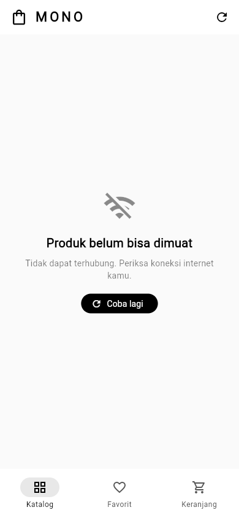

# LAPORAN UTS PEMROGRAMAN MOBILE

## MONO Store: Katalog Produk Berbasis API DummyJSON

Status: DRAF. Nama, NIM, jurusan, fakultas, perguruan tinggi, dan logo fakultas belum diberikan oleh mahasiswa. Bagian cover harus dilengkapi dan diperiksa sebelum pengumpulan. Logo aplikasi merupakan ikon impor Google Material Icons; logo aplikasi tidak menggantikan logo fakultas pada cover.

Mata kuliah: Pemrograman Mobile

Tahun penyusunan: 2026

## BAB I. PENDAHULUAN

### 1.1 Latar Belakang dan Gambaran Aplikasi

Pengguna membutuhkan cara sederhana untuk menelusuri informasi produk, membandingkan harga, dan menyimpan pilihan yang menarik. Data produk dapat berubah sehingga penggunaan data statis saja tidak cukup menggambarkan aplikasi yang terhubung ke layanan daring. MONO Store dikembangkan sebagai aplikasi katalog produk yang mengambil data dinamis dari DummyJSON menggunakan Flutter dan bahasa Dart.

Tujuan pengembangan aplikasi adalah menampilkan katalog dari API, mengolah JSON menjadi objek Dart, menerapkan pemrograman asinkron melalui FutureBuilder, dan menyediakan antarmuka yang mudah digunakan. Sasaran pengguna adalah pengguna umum yang ingin mencoba penelusuran katalog dan simulasi keranjang belanja. Aplikasi ini merupakan proyek pembelajaran dan tidak melakukan pembayaran maupun transaksi komersial.

Tampilan aplikasi menggunakan tema hitam, putih, dan abu-abu. Foto produk mempertahankan warna aslinya agar informasi visual produk tetap jelas. Logo launcher diimpor dari Google Material Design Icons, sedangkan header menggunakan ikon yang diimpor dari pustaka Material Flutter. Tidak ada logo aplikasi yang dibuat menggunakan generator gambar dan tidak digunakan dependensi cupertino_icons.

### 1.2 Fitur Aplikasi

- Katalog dinamis: menampilkan foto, nama, kategori, harga USD, rating, dan ketersediaan stok dari API.
- Pencarian: mencocokkan kata kunci dengan judul, merek, atau deskripsi produk tanpa request tambahan setiap kali pengguna mengetik.
- Filter kategori: mempersempit daftar produk berdasarkan kategori yang terdapat dalam respons API.
- Pengurutan: menampilkan rekomendasi berdasarkan ID, harga terendah/tertinggi, atau rating tertinggi.
- Detail produk: menampilkan deskripsi, merek jika tersedia, stok, rating, harga, dan galeri foto yang dapat digeser.
- Favorit: menyimpan pilihan produk selama sesi aplikasi berjalan.
- Keranjang simulasi: menambah dan mengurangi jumlah produk serta menghitung total dengan membatasi jumlah sesuai stok.
- Muat ulang dan retry: memperbarui katalog, menampilkan loading, serta memberikan pesan saat permintaan gagal.

## BAB II. PEMBAHASAN

### 2.1 Persiapan Project dan Package

Project disimpan sebagai aplikasi Flutter mandiri pada folder UTS dalam repositori MobilePrak. Folder praktikum sebelumnya dipertahankan. Pada pembuatan project Flutter baru, nama paket Dart harus menggunakan huruf kecil, sehingga folder pengumpulan UTS menggunakan nama paket uts_store. Perintah awal yang setara adalah flutter create --project-name uts_store --platforms android,web UTS. Konfigurasi Android dan web kemudian dilengkapi sesuai kebutuhan aplikasi.

Lingkungan pengujian menggunakan Flutter 3.47.7, Dart 3.13.5, JDK 21.0.12.1, Android SDK 36, dan Android Gradle Plugin 9.1.0. Hasil APK debug memiliki minimum Android API 24, target API 36, dan arsitektur ARM64. AndroidManifest.xml utama memuat izin android.permission.INTERNET agar akses API juga tersedia pada build release.

Struktur utama project adalah sebagai berikut.

```text
UTS/
  lib/
    main.dart
    pages/store_page.dart
    models/product.dart
    services/product_service.dart
    widgets/product_image.dart
  test/
    product_service_test.dart
    store_test.dart
  android/
  web/
  docs/
  tool/
  pubspec.yaml
  pubspec.lock
  README.md
```

main.dart berisi entry point serta tema aplikasi. StorePage mengatur FutureBuilder dan interaksi antarmuka. Product menyimpan model data. ProductService menangani komunikasi HTTP dan parsing respons. ProductImage memusatkan tampilan gambar, indikator pengunduhan, dan fallback ketika gambar tidak tersedia. Pemisahan tersebut memudahkan pengujian layanan API tanpa harus menjalankan tampilan aplikasi.

Package tambahan aplikasi adalah http, yang digunakan untuk mengirim permintaan GET dan memudahkan injeksi HTTP client saat pengujian. flutter_test digunakan sebagai dependensi pengembangan untuk menguji model alur API dan interaksi widget. flutter_lints membantu analisis statis. Package cupertino_icons tidak dicantumkan dalam pubspec.yaml maupun lockfile. Material Icons tersedia melalui SDK Flutter dan uses-material-design: true.

Langkah menjalankan project dari hasil unduhan adalah sebagai berikut.

```sh
cd UTS
flutter pub get --enforce-lockfile
flutter devices
flutter run
```

Pengguna perlu menyediakan perangkat Android dengan USB debugging atau emulator. Build APK yang diverifikasi pada cloud dibuat dengan flutter build apk --debug --target-platform android-arm64. Tool dokumentasi berbasis Python hanya digunakan untuk menyusun laporan dan mengambil screenshot; tool tersebut bukan dependensi aplikasi Android.

### 2.2 Desain Antarmuka Pengguna (User Interface)

Halaman katalog menggunakan AppBar berlogo, judul pengantar, TextField pencarian, DropdownButton kategori, menu pengurutan, dan grid produk responsif. NavigationBar menyediakan navigasi katalog, favorit, dan keranjang. Ukuran grid mengikuti lebar layar dan skala teks. Kartu produk menyediakan tombol favorit dan tombol penambahan ke keranjang. Semua status penting disampaikan dengan teks sehingga pengguna tidak hanya bergantung pada perubahan warna.


Kolom pencarian bekerja pada data yang telah berhasil diunduh. Penyaringan kategori dan pengurutan juga dilakukan secara lokal. Pendekatan ini menjaga interaksi tetap responsif dan menghindari permintaan jaringan yang tidak diperlukan untuk katalog berukuran kecil ini.



Halaman favorit menggunakan komponen katalog yang sama dengan penyaringan berdasarkan ID produk yang disimpan pengguna. Data favorit disimpan dalam memori selama aplikasi terbuka.



Detail ditampilkan melalui modal bottom sheet yang dapat digulir. Informasi yang lebih panjang dipindahkan ke detail agar kartu katalog tetap ringkas. Galeri menggunakan PageView jika API menyediakan beberapa gambar.



Keranjang menampilkan produk terpilih, jumlah barang, kontrol pengurangan/penambahan, dan total harga dalam USD. Tombol tambah dinonaktifkan setelah jumlah mencapai stok. Ketika jumlah dikurangi sampai nol, baris produk dihapus. Halaman ini menyatakan dengan jelas bahwa transaksi hanya merupakan simulasi.



Screenshot dalam laporan diambil dari aplikasi Flutter web pada viewport ponsel 390 x 844 piksel. Screenshot tersebut membuktikan tampilan aplikasi, bukan hasil pemasangan APK pada perangkat Android fisik. Foto produk adalah aset dari API, sedangkan UI aplikasi tetap menggunakan palet monokrom.

### 2.3 Implementasi Pengambilan dan Pengolahan Data dari API

URL API yang digunakan adalah https://dummyjson.com/products. Permintaan katalog menggunakan parameter limit=0 untuk mengambil semua produk yang disediakan endpoint. Struktur respons diperiksa sebelum penyesuaian implementasi. Respons memiliki properti products berupa array, serta total, skip, dan limit sebagai metadata. Saat pengujian, respons berisi 194 produk; jumlah ini dapat berubah mengikuti penyedia data.

Setiap produk dapat memuat id, title, description, category, price, rating, stock, brand, thumbnail, images, serta atribut tambahan seperti dimensions, reviews, dan shippingInformation. Aplikasi memilih atribut yang relevan untuk katalog. Sampel respons nyata disimpan pada docs/contoh_respons_api.json agar struktur sumber data dapat diperiksa kembali.

```json
{
  "products": [
    {
      "id": 1,
      "title": "Essence Mascara Lash Princess",
      "price": 9.99,
      "category": "beauty"
    }
  ],
  "total": 194,
  "skip": 0,
  "limit": 194
}
```

Potongan JSON di atas diringkas untuk pembahasan; file contoh respons berisi atribut yang lebih lengkap. Nilai harga ditampilkan sebagai USD sesuai dokumentasi sumber, tanpa menyatakan nilai tersebut sebagai rupiah.

ProductService mengirim permintaan secara asynchronous dengan await. URI dibuat menggunakan Uri.https sehingga skema HTTPS dan query parameter tersusun dengan benar. Batas waktu 20 detik digunakan agar pengguna tidak menunggu tanpa batas.

```dart
final response = await _client
    .get(Uri.https('dummyjson.com', '/products', {'limit': '0'}))
    .timeout(const Duration(seconds: 20));
if (response.statusCode != 200) {
  throw ProductApiException(
    'Server mengembalikan HTTP ${response.statusCode}. Coba lagi nanti.',
  );
}
final data = jsonDecode(utf8.decode(response.bodyBytes));
```

Setelah status respons diperiksa, jsonDecode mengonversi JSON menjadi struktur Map/List Dart. Layanan memeriksa bahwa properti products berupa List dan setiap elemennya berupa Map sebelum membentuk objek model. Respons rusak, tipe data salah, kegagalan koneksi, dan timeout diterjemahkan menjadi ProductApiException yang pesannya dapat dipahami pengguna.

```dart
return (data['products'] as List).map((item) {
  if (item is! Map<String, dynamic>) {
    throw const FormatException('Data produk tidak valid.');
  }
  return Product.fromJson(item);
}).toList();
```

Product.fromJson memvalidasi id, title, dan price, lalu mengonversi nilai numerik ke tipe yang diperlukan. Field opsional seperti brand dan images memiliki nilai cadangan. Proses ini membuat widget menggunakan objek Product dengan tipe yang jelas, bukan membaca JSON mentah di setiap komponen tampilan.

```dart
final id = json['id'];
final title = json['title'];
final price = json['price'];
if (id is! int || title is! String || price is! num || price < 0) {
  throw const FormatException('Data produk tidak valid.');
}
```

Penerapan asynchronous pada tampilan menggunakan FutureBuilder sesuai ketentuan UTS. Future disimpan dalam state dan dibuat melalui initState. Future tidak dibuat ulang di build karena build dapat dipanggil ketika pencarian, navigasi, atau favorit berubah. Future baru hanya diberikan ketika pengguna melakukan refresh atau retry.

```dart
late Future<List<Product>> _productsFuture;

@override
void initState() {
  super.initState();
  _service = widget.service ?? ProductService();
  _productsFuture = _fetchProducts();
}

@override
Widget build(BuildContext context) {
  return FutureBuilder<List<Product>>(
    future: _productsFuture,
    builder: (context, snapshot) => _scaffold(snapshot),
  );
}
```

Saat connectionState bernilai waiting dan belum ada data, aplikasi menampilkan CircularProgressIndicator serta teks Mengambil produk. Ketika Future selesai dengan sukses, hasil Product digunakan untuk menyajikan katalog. Jika snapshot.hasError dan belum ada katalog, aplikasi menampilkan pesan kegagalan beserta tombol Coba lagi. Ketika refresh gagal setelah sebelumnya berhasil, katalog terakhir tetap ditampilkan dan pengguna menerima SnackBar berisi pesan kegagalan.




Penanganan lifecycle menggunakan mounted sebelum memperbarui data state setelah operasi asynchronous. Permintaan yang sedang berjalan juga dijaga agar tindakan muat ulang tidak mengirim request ganda. Jika data stok berubah setelah refresh, jumlah barang di keranjang disesuaikan dengan stok terbaru dan produk yang tidak lagi tersedia di katalog dibersihkan dari pilihan pengguna.

### 2.4 Pengujian Aplikasi

Pengujian dilakukan pada lapisan layanan, antarmuka, integrasi API asli, dan build. Tes layanan menggunakan MockClient dari package http sehingga status HTTP, JSON rusak, kegagalan koneksi, dan timeout dapat diuji secara terkontrol. Tes widget menggunakan layanan palsu dan Completer untuk mengamati perubahan loading menjadi sukses/error. Tes tersebut merupakan simulasi yang disengaja dan tidak dianggap sebagai kegagalan layanan DummyJSON.

- Sebelas tes layanan API lulus: endpoint HTTPS dan konversi data, katalog kosong, respons HTTP 403/404/500, empat bentuk respons rusak, kegagalan koneksi, dan timeout.
- Sebelas tes widget lulus: FutureBuilder loading ke sukses, FutureBuilder error, Future stabil saat rebuild, API kosong, pencarian, kategori/pengurutan, detail/keranjang/batas stok, favorit, retry, refresh gagal dengan data lama, dan layout sempit.
- flutter analyze selesai tanpa temuan; flutter test menjalankan 22 tes dan seluruhnya lulus.
- Pengecekan API asli menggunakan ProductService berhasil memperoleh 194 produk pada saat validasi.
- Build web dan APK debug ARM64 berhasil; manifest APK memuat izin internet dan minimum Android API 24.
- Pengujian browser memakai API asli untuk alur normal. Kondisi loading/error untuk screenshot diuji dengan menahan/menggagalkan request secara khusus, kemudian memulihkan request dan menjalankan retry.

APK belum dipasang dan diuji pada ponsel fisik atau emulator Android. Oleh sebab itu, keberhasilan build dan pengujian widget tidak dinyatakan sebagai bukti bahwa semua tipe perangkat Android sudah teruji. Bukti log akhir tersedia pada docs/hasil_pengujian.txt.

## BAB III. PENUTUP

### 3.1 Kesimpulan

MONO Store telah mengimplementasikan aplikasi Flutter/Dart dengan GUI yang menyajikan data produk dari API DummyJSON. Proses pengiriman HTTP, pemeriksaan status, decoding JSON, dan pembentukan objek Product dipisahkan ke layanan dan model. FutureBuilder menangani perubahan kondisi loading, sukses, dan error, sedangkan fitur pencarian, kategori, detail, favorit, dan keranjang memanfaatkan atribut produk yang telah diperoleh.

Hasil 22 tes otomatis, analisis statis, pengecekan API asli, serta build web dan APK debug menunjukkan bahwa fungsi yang diuji bekerja sesuai rancangan. Validasi perangkat Android fisik masih perlu dilakukan sebelum digunakan sebagai bukti kompatibilitas pada perangkat tertentu. Dokumen ini masih berstatus draf selama identitas mahasiswa dan logo fakultas belum dilengkapi.

### 3.2 Saran

Pengembangan berikutnya dapat menambahkan penyimpanan lokal agar favorit dan keranjang tetap tersedia setelah aplikasi ditutup. Untuk data yang lebih besar, pencarian dan pagination dapat dilakukan melalui server agar penggunaan memori dan transfer data lebih hemat. Pengujian juga dapat diperluas ke perangkat Android dengan ukuran layar dan versi sistem yang berbeda. Fitur pembayaran membutuhkan rancangan backend, autentikasi, dan pengamanan tersendiri; fitur tersebut tidak termasuk dalam simulasi saat ini.

## DAFTAR PUSTAKA

- Flutter. Dokumentasi resmi Flutter. https://docs.flutter.dev/
- Flutter. FutureBuilder class. https://api.flutter.dev/flutter/widgets/FutureBuilder-class.html
- Dart. Asynchronous programming: futures, async, await. https://dart.dev/libraries/async/async-await
- Dart. JSON and serialization. https://docs.flutter.dev/data-and-backend/serialization/json
- Dart Team. Package http. https://pub.dev/packages/http
- DummyJSON. Products API documentation. https://dummyjson.com/docs/products
- Google. Material Design Icons. https://github.com/google/material-design-icons
- Flutter. Testing Flutter apps. https://docs.flutter.dev/testing/overview

## CATATAN PENGUMPULAN

Lengkapi identitas dan logo fakultas, lalu periksa ulang PDF akhir. Repositori pengumpulan adalah https://github.com/4zzaa/MobilePrak dengan project pada folder UTS. Laporan PDF perlu diunggah ke Google Drive oleh pemilik akun dengan akses Anyone with the link / Viewer. Tautan Google Drive belum tersedia dan akses publiknya belum dapat diuji. Dua tautan pengumpulan, yaitu GitHub dan Google Drive, harus diuji tanpa login sebelum diserahkan. Tenggat pada ketentuan adalah 23 Oktober 2026 pukul 23.59 WIB.
